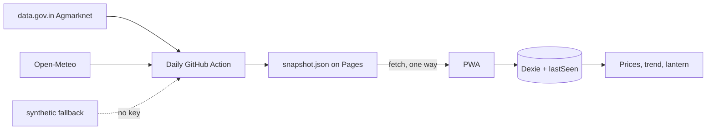

# Design: Mandi Ghost

## Source: data.gov.in (finding, 2026-11-13)
- Dataset page: <https://data.gov.in/resource/current-daily-price-various-commodities-various-markets-mandi> ("Current Daily Price of Various Commodities from Various Markets (Mandi)", source Agmarknet, Ministry of Agriculture; Open Government Data Licence India). Fields: state, district, market, commodity, variety, grade, arrival_date, min_price, max_price, modal_price (Rs per quintal).
- API shape: `GET https://api.data.gov.in/resource/<resource-id>?api-key=<KEY>&format=json&limit=1000&offset=0&filters[state]=Telangana`. The commonly cited id is `9ef84268-d588-465a-a308-a864a43d0070`; NOT verified live (the portal was unreachable from the build seat, and a search snippet says the listing shows "Request API" with no API). The builder must confirm id and fields once with a free key.
- **An API key is needed** (free registration at data.gov.in). Store as GitHub secret `DATA_GOV_IN_KEY`; never commit it.
- **No-key fallback:** committed `apps/mandi-ghost/public/snapshot.json`, `"synthetic": true`, banner "synthetic sample data". Built by `scripts/make-synthetic.mjs` from a fixed seed.
- Weather: Open-Meteo, CC-BY 4.0, <https://open-meteo.com/en/docs>, no key, attribution shown in the About screen.

## Data flow

No arrow goes from the app back to any server. The only local write is the picker preference.

## Skeleton modules
- USES: `store.ts` (Dexie, lastSeen), `lantern.ts`, `i18n.ts` (en + te), `clear.ts`, `pwa.ts`, `styles/base.css`.
- DOES NOT USE: `crdt.ts` (no merges, one writer), `payload.ts` (nothing is shared as text), y-webrtc, y-indexeddb.

## UI layout (distinct: a read-only dashboard)
Top: lantern bar with "last seen Xh ago". Under it: market picker and commodity picker (two selects). Centre: a big price card (modal price, min, max). Below: a 7-day trend sparkline in inline SVG with a table fallback, then a weather strip (today and 3 days). Footer: language toggle, Clear all, attribution. No input fields, no compose action.

## Tests (Vitest, fast-check 1000 runs where PBT)
- PBT: snapshot row cleaner drops every malformed row and keeps every valid one (1000 runs).
- PBT: trend builder keeps at most 7 points, sorted by date, for any row order (1000 runs).
- PBT: "Xh ago" formatter is monotone in age and never negative (1000 runs).
- Unit: store round trip keeps `lastSeen`; offline render uses Dexie only (fetch mocked to fail).
- Unit: fallback sets `synthetic: true` when the key is missing.
- Offline e2e (sbx browse): Network Offline then reload shows prices and the lantern; online refresh within 60 s.
- axe scan zero serious or critical; Clear all empties IndexedDB.
