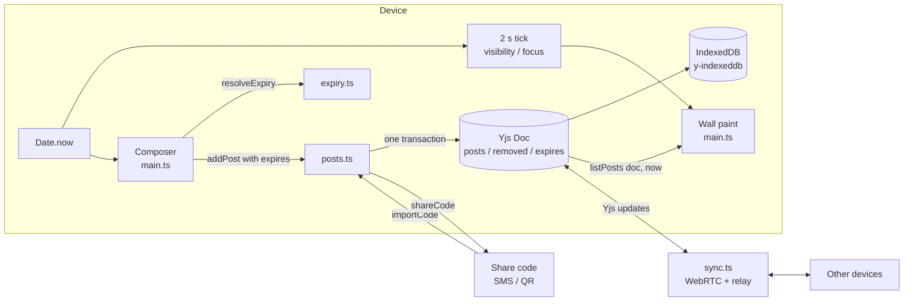
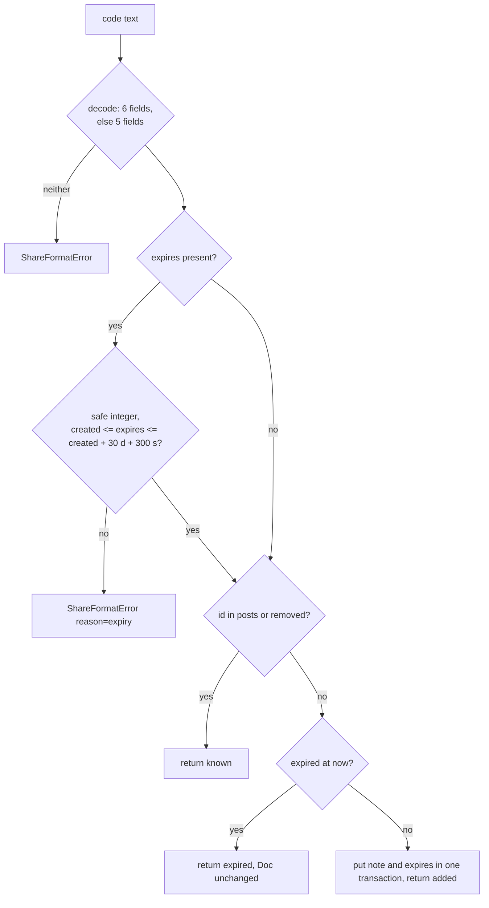

# Design Document: Note Expiry

## Overview

Seance Board notes get an optional expiry time. The author picks it in the Composer. It is stored as an absolute epoch-seconds number in a new Yjs map `expires` (note id to seconds), in the same Doc as the note, and written in the same transaction as the note. Every device decides for itself, from its own clock, whether to hide a note. Hiding never writes to the Doc, so merges stay commutative, idempotent and convergent and nothing is deleted.

### Findings from the code that shape the design

| Finding | Where | Consequence |
|---|---|---|
| Notes are `posts[id] = [text, category, created, nick]`; `removed[id] = true` is a soft delete. `listPosts()` already skips malformed peer tuples. | `posts.ts` | Expiry follows the `removed` pattern: a second side map keyed by id. A malformed `expires` value then cannot make the whole note disappear (Req 5.8). It is read as "no expiry". |
| Notes reach other devices as whole-Doc Yjs updates: y-webrtc, the relay (`Y.applyUpdate(doc, ...)` in `relay.ts`) and IndexedDB. | `sync.ts`, `relay.ts` | A new map travels with no change to `sync.ts` or `relay.ts`. Clear all already removes it, because the map lives in the board's Doc and database (Req 3.5). |
| Yjs maps are last-writer-wins per key, and ids are unique per note. | `crdt.ts` | If `expires[id]` is written only inside the transaction that creates the note (Req 5.7), no two replicas can hold different values for one id. |
| `createCodec()` fixes the field count. A 5-field code fed to a 6-field codec fails with "wrong field count". The encoder throws `PayloadTooLargeError` above `maxChars` (160). | `payload.ts` | Two codecs: the existing 5-field one, and a 6-field one used only when a note has an expiry. Notes without expiry produce byte-identical codes to today, so they stay readable by devices that lack this feature (Req 7.4). |
| `decodeShare()` already rejects `created` more than 300 s ahead of the clock. `importCode()` returns `known` for a known or removed id. | `posts.ts` | Reuse 300 s as `SKEW_GRACE`. Extend the `importCode()` result with `expired`. |
| `shareCode()` loops over shorter texts to compute `cut`. | `posts.ts` | It works unchanged once it picks the right codec. The expiry field costs about 12 base64 characters, which the loop reports as extra characters to cut (Req 7.3). |
| `main.ts` repaints the whole wall on every Doc `update` and has no timer. | `main.ts` | Add one 2-second tick. It repaints only when the visible id set changes and otherwise updates the "expires in" labels in place, so keyboard focus is not lost. |
| `i18n.ts` `en` is a `const` table; `te` is `Partial`. `tr()` checks `key in en`, so dotted keys such as `expiry.none` work. | `i18n.ts` | Add `expiry.*` keys to both tables. Export both tables so a test can check parity and `{n}` placeholders. |

### Design decisions

1. **Separate `expires` map, not a fifth tuple slot.** A malformed tuple makes `listPosts()` drop the note; a malformed map entry only loses the expiry. The tuple also already carries an optional `nick` at index 3.
2. **Derived, not stored, state.** "Expired" is computed from `now` on every read. No flag is written, so a wrong clock cannot destroy data and a clock that moves backwards shows the note again (Req 6.3).
3. **Read-time clamp.** `effectiveExpiry()` caps an expiry at `created + MAX_HORIZON` when a peer wrote more than `MAX_HORIZON + SKEW_GRACE` after creation, so nobody can pin a note with a far-future expiry (Req 6.6).
4. **Pure helpers in two files.** `posts.ts` holds the rule and Doc code (`isExpired`, `effectiveExpiry`, `checkExpiry`, codecs). A new `expiry.ts` holds Composer helpers (presets, picked-time parsing, remaining-time words). `expiry.ts` imports from `posts.ts`, never the reverse.
5. **Optional share-code field.** No expiry gives the existing 5-field code. An expiry gives a 6-field code. Decode tries 6 fields, then 5.

## Architecture



Import flow for a share code (Req 3.4, 6.4 to 6.5, 7.4, 7.6, 7.8):



## Components and Interfaces

### `apps/seance-board/src/posts.ts` (changed)

```ts
export const MAX_HORIZON = 30 * 24 * 3600; // 2_592_000 s
export const MIN_LEAD = 60;                // s
export const SKEW_GRACE = 300;             // s

export interface Post { /* existing fields */ expires?: number }  // effective expiry, epoch seconds

/** Req 1. Pure: depends only on its arguments. Non-integer expiry means "no expiry". */
export const isExpired = (expiry: unknown, nowSeconds: number): boolean =>
  Number.isInteger(expiry) && nowSeconds >= (expiry as number);

/** Req 5.8, 6.6. Raw map value to the expiry used for display and sharing, or undefined. */
export function effectiveExpiry(created: number, raw: unknown): number | undefined;
//  not an integer                          -> undefined
//  raw > created + MAX_HORIZON + SKEW_GRACE -> created + MAX_HORIZON
//  result below MIN_SAFE_INTEGER            -> MIN_SAFE_INTEGER (always expired)
//  otherwise                                -> raw

export class PostExpiryError extends Error {
  constructor(public readonly kind: 'invalid' | 'tooSoon' | 'tooFar', public readonly bound?: number) // bound: epoch s, earliest or latest allowed
}

/** Req 4.4, 4.5. created is whole seconds. Throws PostExpiryError. */
export function checkExpiry(created: number, expires: number): void;
//  not a safe integer              -> 'invalid'
//  expires - created < MIN_LEAD     -> 'tooSoon', bound = created + MIN_LEAD
//  expires - created > MAX_HORIZON  -> 'tooFar',  bound = created + MAX_HORIZON

export function addPost(d, rawText, category, now?, rnd?, nick?, expires?: number): Post;
//  validates text, then checkExpiry(floor(now / 1000), expires) when given, then put() (both maps, one transaction)

export function listPosts(d: Y.Doc, nowSeconds?: number): Post[];
//  nowSeconds defaults to floor(Date.now() / 1000), so existing callers and tests keep working.
//  Returns notes that are not removed and not isExpired(effectiveExpiry(...), nowSeconds), in the existing order.
//  Never writes to the Doc.

export type ImportResult = 'added' | 'known' | 'expired';
export function importCode(d: Y.Doc, input: string, nowSeconds?: number): ImportResult;

export class ShareFormatError extends Error { constructor(message: string, public readonly reason?: 'expiry') }
```

Internals:

- `expires(d) = d.getMap<unknown>('expires')`.
- `put(d, p)` sets `posts` and `removed` as today and also `expires[id] = p.expires` when defined, all in the existing single `d.transact`. It still returns false when the id already exists, so an existing note's expiry is never overwritten (Req 5.7).
- `removePost` is unchanged. It writes only `removed`, so the expiry is kept (Req 3.3).
- `listPosts` reads `expires(d).get(id)` per note and passes it through `effectiveExpiry(created, raw)`. A throw is impossible by construction: the value is `unknown` and is only tested with `Number.isInteger`.
- Codecs: `codec` (existing, 5 fields) is unchanged. `codecExpiry` adds a sixth field `{ name: 'expires', type: 'int' }`, also with `MAX_CODE`.
- `shareCode(p)` uses `codecExpiry` when `p.expires !== undefined`, otherwise `codec`. The cut loop is unchanged. `p.expires` is the effective expiry, so a clamped value is always within what `decodeShare` accepts.
- `decodeShare(input)` tries `codecExpiry.decode`, and on `PayloadFormatError` tries `codec.decode`. If both fail it throws `ShareFormatError` with the 5-field error. When the 6-field codec succeeded, it also requires `Number.isSafeInteger(expires)`, `expires >= created` and `expires <= created + MAX_HORIZON + SKEW_GRACE`. Any failure throws `ShareFormatError('bad expiry', 'expiry')`.
- `importCode(d, input, now)` follows the flow diagram above. The known check comes before the expired check, so a known id answers `known` even when expired (Req 3.4).

### `apps/seance-board/src/expiry.ts` (new, DOM-free)

```ts
export type ExpiryChoice = 'none' | 'h1' | 'h6' | 'h24' | 'd7' | 'pick';
export const PRESET_SECONDS = { h1: 3600, h6: 21_600, h24: 86_400, d7: 604_800 } as const;

/** Req 4.3, 4.6. `picked` is a datetime-local value ("YYYY-MM-DDTHH:mm"), read in the device time zone.
 *  Returns epoch seconds, or undefined for 'none'. Throws PostExpiryError('invalid') for an empty,
 *  malformed or non-existent date (for example 2026-02-31). Range errors come later from checkExpiry. */
export function resolveExpiry(choice: ExpiryChoice, picked: string, nowMs: number): number | undefined;

export type Remaining = { unit: 'lt1m' | 'm' | 'h' | 'd'; n: number };
/** Req 4.7, 8.4. Under 60 s: lt1m. Under 1 h: whole minutes. Under 24 h: whole hours. Else whole days. All floored. */
export function remaining(expires: number, nowSeconds: number): Remaining;
```

Presets are `floor(nowMs / 1000) + seconds`, which is exactly the `created` second that `addPost` derives from the same `now`.

### `apps/seance-board/src/main.ts` (changed)

- **Composer.** A `<label for="expiry">` and `<select id="expiry">` with six `<option data-k="expiry.*">`, "no expiry" first. Below it a `<label for="expPick">` and `<input id="expPick" type="datetime-local" hidden>`, shown only for "pick a date and time". `min` and `max` on the input are hints only. `checkExpiry` is the authority. Both controls reuse the existing control styles and get `min-height: 2.75rem` (44 px). They use the global focus ring.
- **Submit.** Read `const now = Date.now()` once. Call `resolveExpiry(choice, expPick.value, now)`, then `addPost(doc, text, cat, now, Math.random, nick, expires)`. Catch `PostExpiryError` next to the existing `PostTextError` and write the message into the existing `#msg` (`role="alert"`): `expiry.err_invalid`, `expiry.err_soon` with `{time}`, or `expiry.err_far` with `{time}`. `{time}` is `Intl.DateTimeFormat(lang === 'te' ? 'te-IN' : 'en-IN', { dateStyle: 'medium', timeStyle: 'short' })` applied to `bound * 1000`. After a successful post, set the select to `none` and hide the picker (Req 4.8).
- **Card.** When `p.expires !== undefined`, add `<span class="sb-exp" data-exp="<seconds>">` with text `T('expiry.left_' + unit, { n })`. It is text, not colour, and uses the existing muted text token. No animation.
- **Paint and tick.** `paintWall(now = nowSec())` calls `listPosts(doc, now)` and stores the joined visible ids as `shownKey`. `tick()` recomputes that key. If it differs, it calls `paintWall()`. Otherwise it rewrites each `.sb-exp` label from its `data-exp`. `setInterval(tick, 2000)` gives disappearance within 5 s (Req 2.3). `tick` also runs on `visibilitychange` and `pageshow`, because browsers throttle timers in background tabs. Because the key is recomputed from the clock each time, a clock that moves backwards brings the note back (Req 6.3).
- **Share.** `openShare` first checks `isExpired(p.expires, nowSec())`. If true it repaints and returns without opening the dialog (Req 7.7).
- **Paste.** `paste()` maps `'expired'` to `expiry.expiredCode`. A `ShareFormatError` with `reason === 'expiry'` maps to `expiry.badCode`. Everything else keeps `badCode`.
- Language change already calls `setText()`, which repaints the wall and re-translates `[data-k]`, so the labels and options follow the language (Req 8.8). The footer help lines are untouched (Req 8.9).

### `apps/seance-board/src/i18n.ts` (changed)

New keys, all under the `expiry.` prefix, added to `en` and `te` together. Each Telugu value carries `// TODO(te)` (Req 8.3). `en` and `te` become exported so a test can compare them.

| Key | English | Placeholders |
|---|---|---|
| `expiry.label` | Expires | |
| `expiry.none` | No expiry | |
| `expiry.h1`, `expiry.h6`, `expiry.h24`, `expiry.d7` | In 1 hour, In 6 hours, In 24 hours, In 7 days | |
| `expiry.pick` | Pick a date and time | |
| `expiry.pickLabel` | Expiry date and time | |
| `expiry.left_lt1m` | expires in less than a minute | |
| `expiry.left_m`, `expiry.left_h`, `expiry.left_d` | expires in {n} min, expires in {n} h, expires in {n} d | `{n}` |
| `expiry.err_invalid` | Choose a valid date and time | |
| `expiry.err_soon` | Expiry must be at least a minute from now. Earliest: {time} | `{time}` |
| `expiry.err_far` | Expiry must be within 30 days of posting. Latest: {time} | `{time}` |
| `expiry.expiredCode` | That note has already expired | |
| `expiry.badCode` | That code has an invalid expiry time | |

### Unchanged

`sync.ts`, `relay.ts`, `room.ts`, `qr.ts` and the skeleton need no change. The QR is drawn from whatever string `shareCode()` returns, and the 160-character limit is enforced by the codec.

## Data Models

Yjs maps in the board Doc (persisted by `createDoc()` / y-indexeddb, replicated by Yjs):

| Map | Key | Value | Written by | Notes |
|---|---|---|---|---|
| `posts` | id | `[text, category, created, nick?]` | `put()` | Unchanged. |
| `removed` | id | `true` | `removePost()`, `put()` for removed imports | Unchanged. |
| `expires` | id | integer epoch seconds | `put()` only, in the note's transaction | New. Never updated or deleted. Absence means no expiry. |
| `meta` | `seeded` | boolean | `seedIfNew()` | Unchanged. Seed notes have no expiry. |

`Post.expires` is the effective expiry (after `effectiveExpiry`), not the raw map value.

Share code, a JSON array of field values encoded by `createCodec()` as base64url:

| Variant | Fields | Used when |
|---|---|---|
| 5-field (`codec`) | `id, text, category, created, removed` | Note has no expiry. Identical to the pre-feature format. |
| 6-field (`codecExpiry`) | the above plus `expires` (int, base36) | Note has an expiry. |

Constants: `MAX_HORIZON` 2,592,000 s, `MIN_LEAD` 60 s, `SKEW_GRACE` 300 s, `MAX_CODE` 160 (`SMS_BYTES`).

Clock model: `created` and `now` are whole seconds. Each device compares `expires` with its own clock. A device whose clock is ahead hides a note early, and one whose clock is behind shows it late, by the size of its clock error. This goes into `apps/seance-board/README.md` (Req 6.7).

## Correctness Properties

*A property is a characteristic or behavior that should hold true across all valid executions of a system-essentially, a formal statement about what the system should do. Properties serve as the bridge between human-readable specifications and machine-verifiable correctness guarantees.*

Prework reflection: the boundary, "no expiry" and malformed-value criteria (1.1, 1.2, 1.3, 1.5) collapse into one model-equality property. Criteria 2.2, 2.5, 5.6 and 6.3 add nothing beyond the wall property and the no-write property, because expiry is stateless and every ingress path ends in the same Doc. Criteria 5.3, 5.4 and 5.5 merge into one convergence property. Criteria 3.4 and 7.6 merge into one import-outcome property. Criteria 6.1, 6.2, 1.6, 5.7, 3.5, 8.1, 8.3, 8.5 to 8.7 and section 9 are structural or UI-visual and are covered by example, smoke and axe checks in the Testing Strategy.

### Property 1: Expiry rule matches its definition

*For any* value `x` (an integer, a non-integer number, NaN, Infinity, a string, an object, null or undefined) and any integer `now`, `isExpired(x, now)` equals `Number.isInteger(x) && now >= x`. In particular it is false for `undefined` at every `now`, false at `E - 1`, and true at `E` and `E + 1` for every integer `E`.

**Validates: Requirements 1.1, 1.2, 1.3, 1.5**

### Property 2: Expiry is monotonic in time

*For any* expiry `E` and any times `T1 <= T2`, if `isExpired(E, T1)` is true then `isExpired(E, T2)` is true.

**Validates: Requirements 1.4**

### Property 3: Effective expiry normalises and clamps

*For any* `created` and any raw value, `effectiveExpiry(created, raw)` is `undefined` when `raw` is not an integer. It is `created + MAX_HORIZON` when `raw > created + MAX_HORIZON + SKEW_GRACE`. Otherwise it is `raw` (floored at `MIN_SAFE_INTEGER`). Its result never exceeds `created + MAX_HORIZON + SKEW_GRACE`.

**Validates: Requirements 5.8, 6.6**

### Property 4: The wall is exactly the unremoved, unexpired notes

*For any* set of notes (with and without expiry, some removed, created across up to 4 replicas and merged) and any `now`, `listPosts(doc, now)` returns exactly the unremoved notes whose effective expiry is not expired at `now`, in the existing order (newest first, ties by id). Evaluating the same Doc at an earlier `now` returns every note that was hidden only by a later `now`.

**Validates: Requirements 2.1, 2.2, 2.4, 2.5, 6.3, 9.5**

### Property 5: Expiry never writes to the Doc

*For any* Doc and any two times `t1 <= t2`, the state vector and the encoded state are identical before and after calling `listPosts` at `t1` and at `t2`, including when `t2` is past a note's expiry. The `posts`, `removed` and `expires` maps keep every entry.

**Validates: Requirements 3.1, 3.2, 5.6, 9.6**

### Property 6: Removing a note keeps its expiry

*For any* note created with an expiry, `removePost` sets `removed[id]` and leaves `expires[id]` equal to its prior value.

**Validates: Requirements 3.3**

### Property 7: Creation writes note and expiry together and enforces bounds

*For any* `now`, text, category and `expires`: if `MIN_LEAD <= expires - created <= MAX_HORIZON`, then `addPost` makes `posts[id]` and `expires[id]` appear in the Doc in one update, with `listPosts` returning `Post.expires === expires`. Otherwise `addPost` throws `PostExpiryError` with kind `tooSoon` (bound `created + MIN_LEAD`) or `tooFar` (bound `created + MAX_HORIZON`) and the Doc state vector is unchanged. A non-safe-integer `expires` throws kind `invalid`.

**Validates: Requirements 4.3, 4.4, 4.5, 5.1**

### Property 8: Composer choices resolve to the right instant

*For any* `nowMs`, `resolveExpiry('none', ...)` is `undefined`, and each preset gives `floor(nowMs / 1000) + PRESET_SECONDS[choice]`. *For any* valid local date and time, `'pick'` gives the epoch seconds of that local time (the value equals `Math.floor(new Date(y, m - 1, d, h, min).getTime() / 1000)`). *For any* string that is empty, not in `YYYY-MM-DDTHH:mm` form, or names a day that does not exist, `'pick'` throws `PostExpiryError('invalid')`.

**Validates: Requirements 4.3, 4.6**

### Property 9: Remaining time in words

*For any* `expires` and `now`, `remaining(expires, now)` returns `lt1m` when `0 <= expires - now < 60`, minutes `floor(s / 60)` when `s < 3600`, hours `floor(s / 3600)` when `s < 86400`, and days `floor(s / 86400)` otherwise (with `s = expires - now`). The unit never goes from a larger unit to a smaller one as `s` decreases by one second, except to the next unit down at its boundary, and `n >= 1` for every unit except `lt1m`.

**Validates: Requirements 4.7, 8.4**

### Property 10: Replicas converge, and merging is idempotent

*For any* notes (with and without expiry) created on up to 4 replicas, applying the replicas' updates in any generated order and with any duplication yields the same state vector, the same `expires` entry for every id (equal to the value written with that note), and the same `listPosts` result at any generated `now`. Applying any update a second time leaves the state vector unchanged. Encoding a Doc and applying it to an empty Doc (an IndexedDB reload) gives the same `listPosts` result at the same `now`.

**Validates: Requirements 5.2, 5.3, 5.4, 5.5, 9.7**

### Property 11: Malformed expires entries never throw

*For any* value written by a peer into `expires[id]` (strings, floats, NaN, Infinity, objects, arrays, null, booleans, huge integers), `listPosts` does not throw. It returns the note as if it had no expiry for non-integers and applies the clamp for huge integers.

**Validates: Requirements 5.8, 9.11**

### Property 12: Share code round trip, size limit and cut count

*For any* note with or without an expiry, if `shareCode` returns a code then it is at most 160 characters and `decodeShare(code)` returns the same id, text, category, created and expires. If it returns `ok: false` with `cut`, then the same note with `cut` fewer text characters fits and with `cut - 1` fewer does not. A note without an expiry produces the same code as the pre-feature encoder.

**Validates: Requirements 7.1, 7.2, 7.3, 7.5, 9.8**

### Property 13: Invalid share-code expiries are rejected and change nothing

*For any* `created` and any `expires` that is earlier than `created`, more than `MAX_HORIZON + SKEW_GRACE` after `created`, or not a safe integer, `importCode` of a code carrying it throws `ShareFormatError` with reason `expiry`, and the Doc state vector is unchanged.

**Validates: Requirements 6.4, 6.5, 7.8, 9.9**

### Property 14: Import outcome depends on known id first, then expiry

*For any* valid code and any `now`: if its id is already in `posts` or `removed`, `importCode` returns `known` and leaves the state vector unchanged, whether or not the note is expired. If the id is unknown and the expiry has passed at `now`, it returns `expired` and leaves the state vector unchanged. Otherwise it returns `added`, and importing the same code again returns `known` with an unchanged state vector.

**Validates: Requirements 3.4, 7.6**

### Property 15: Pre-feature codes still import

*For any* note, a 5-field code made with the existing encoder decodes and imports with no expiry (`Post.expires` is `undefined` and `expires` has no entry for the id).

**Validates: Requirements 7.4, 9.10**

## Error Handling

| Condition | Where detected | Behaviour |
|---|---|---|
| Picked date empty, malformed or non-existent | `resolveExpiry` | `PostExpiryError('invalid')`. Composer shows `expiry.err_invalid` in `#msg`. No note is written. |
| Expiry under 60 s ahead | `checkExpiry` in `addPost` | `PostExpiryError('tooSoon')`. Message names the earliest local time. No write. |
| Expiry over 30 days after created | `checkExpiry` in `addPost` | `PostExpiryError('tooFar')`. Message names the latest local time. No write. |
| Code with expiry before created, beyond horizon plus grace, or unsafe | `decodeShare` | `ShareFormatError(reason 'expiry')`. Paste box shows `expiry.badCode`. Doc untouched. |
| Code that is not valid in either format | `decodeShare` | `ShareFormatError`. Existing `badCode` message. |
| Code for an expired note | `importCode` | Returns `expired`. Paste box shows `expiry.expiredCode`. Doc untouched. |
| Code for a known id | `importCode` | Returns `known`, even if expired. |
| Peer writes junk into `expires` | `effectiveExpiry` | Treated as no expiry (non-integers) or clamped (huge integers). No throw. |
| Device clock wrong | `listPosts(doc, now)` | Note hidden early or shown late on that device only. Nothing is written, so other devices and the data are unaffected. |
| Background tab throttles the timer | `tick` | Re-run on `visibilitychange` and `pageshow`. |
| Share dialog requested for a note that just expired | `openShare` | Wall is repainted and the dialog is not opened. |
| Share text too long once the expiry field is added | `shareCode` | `ok: false, cut: n`, shown with the existing `tooLongShare` message. |

Known limits to state in the README: devices on a build without this feature ignore `expires` and keep showing the note, and they cannot read a 6-field code ("not a valid note code"). Notes without expiry stay fully compatible.

## Testing Strategy

Property-based testing applies: the rule, clamp, bounds, parsing, formatter, codecs and merge are pure or in-memory Yjs logic with large input spaces. UI rendering, i18n tables and CSS use example, smoke and axe checks.

**Library and settings.** vitest with fast-check (already used in `posts.pbt.test.ts`). The new file `apps/seance-board/test/expiry.pbt.test.ts` runs every property with `numRuns: 1000`. Each test carries a comment tag in the form `Feature: note-expiry, Property N: <title>`. Each of Properties 1 to 15 is one property test. Generators reuse the style of `posts.pbt.test.ts` (ASCII and Telugu text, fixed-sequence `rnd`, up to 4 replicas, shuffled and duplicated updates). Property 8's local-time case builds `picked` from generated date parts and compares with `new Date(...)`, so it holds in whatever time zone the test runs in. `now` values are generated around each note's `expires` (below, at and above) so the boundary is hit often.

**Existing suite.** `posts.pbt.test.ts` must stay green unchanged (Req 9.12). `listPosts(d)` and `importCode(d, s)` keep their old call shapes, and `importCode` still returns `added` or `known` for old inputs.

**Example (unit) tests**, in `apps/seance-board/test/expiry.test.ts`:

- i18n parity: every `expiry.*` key in `en` exists in `te`, and the sets of `{...}` placeholders match (Req 8.1, 8.2). A source scan finds `TODO(te)` next to the new `te` lines (Req 8.3).
- Tick behaviour with fake timers: a note with `expires = now + 3` disappears within 5 s without reload, the filter still applies, and a label updates in place without replacing the card element (Req 2.3, 2.4).
- Composer: six options with "no expiry" selected by default, the picker shows only for "pick", the select resets after a successful post, and the error text appears for too-soon, too-far and invalid input (Req 4.1, 4.2, 4.4 to 4.6, 4.8).
- Expired note has no Share button action: `openShare` does not open the dialog (Req 7.7).
- Language switch re-renders the "expires in" text and sets `html[lang]` (Req 8.8). The footer still holds 14416 and 112 (Req 8.9).
- Extend the existing offline test (`lantern-offline.test.ts` style): create a note with expiry with no peers, reload the Doc from `encodeStateAsUpdate`, and compare the wall (Req 5.1, 5.2).
- "Clear all" still removes the board database, including `expires` (existing `clearAll()` test, Req 3.5).

**Non-test checks.** `npm run a11y` (axe) on the Composer with the picker open and on a card with an expiry label. A grep check that new CSS uses only `var(--bk-*)` colours. A manual offline run: DevTools Network = Offline, reload, the board still renders and hides expired notes. The size budget is checked by the existing build: the new code is small and adds no dependency.

**Traceability.** Requirements 1.6, 5.7, 6.1, 6.2 and 6.7 are structural: `isExpired` takes only arguments (Property 1 would fail if it read a clock), `put()` is the only writer of `expires`, and the README documents clock behaviour. They have no separate property test.
