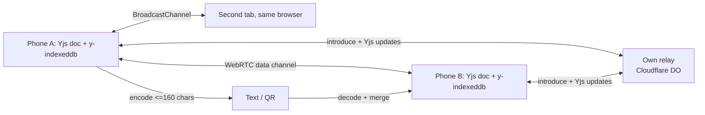

# Design: Seance Board

## Sync transport
- The four y-webrtc public default servers were all unreachable on 2026-11-13 (see Build record). `DEFAULT_SIGNALLING` in `sync.ts` is therefore an empty array; no third-party signalling server is contacted unless a URL is configured.
- Own relay (`signal/`): a Cloudflare Durable Object that speaks the y-webrtc protocol (`subscribe` / `unsubscribe` / `publish` / `ping`). It fans each `publish` to the other sockets subscribed to the same room topic. It stores nothing on disk — topic membership lives in memory only and is lost on eviction. It never sees post content (posts travel over WebRTC data channels after peers are introduced). It refuses messages over 64 KB and caps each socket at 32 subscribed topics. The relay topic for a room is the first 40 hex characters of the SHA-256 of `bone-kit/seance/<roomId>`, so room ids sharing a prefix never share a relay topic. Configured via `VITE_SIGNAL_URL` at build time or the user-settable URL in the Meet sheet.
- Because carrier NAT (observed on Jio, 2026-11-14) can prevent direct WebRTC data channels from opening even after peers are introduced, the relay also carries Yjs update frames directly. `relay.ts` publishes every local `doc.on('update')` and applies incoming updates with `Y.applyUpdate`; Yjs idempotency means receiving the same update over both paths is harmless.
- Fallback "two tabs on one browser": y-webrtc's BroadcastChannel (no network required, same browser only). Active whenever `WebrtcProvider` is running, independent of signalling.

## Data flow

Every device writes and every device is a replica. No device is the source of truth.

## Skeleton modules
- USES: `crdt.ts` (createDoc, merge), `payload.ts` (createCodec: fields id, text, category, created, removed), `lantern.ts` (peers connected or not), `i18n.ts`, `clear.ts`, `pwa.ts`, `styles/base.css`.
- DOES NOT USE: `store.ts` Dexie records (y-indexeddb holds the data), any `lastSeen` price caching, any snapshot fetch or scheduled job.

## UI layout (distinct: a compose-and-wall board)
Top: lantern shows peer count ("2 spirits nearby"). Centre: a card wall of posts, newest first, each with a "synthetic" tag on seed posts. Bottom: a compose bar with a 100-character counter and category chips; the help-line footer sits under it. Side sheet: "Meet" (room id, invite QR, relay URL field — sets the signalling and direct-sync endpoint for the current session; empty means BroadcastChannel only) and "Share as text / Paste code". No price, trend or weather views.

## Tests (Vitest, fast-check 1000 runs)
- PBT: convergence, N replicas receive the same updates in any order and duplicated, all equal (1000 runs).
- PBT: codec round trip for any valid post; any post over 160 chars throws `PayloadTooLargeError` (1000 runs).
- PBT: decode-and-merge of the same code twice leaves one post (idempotent, 1000 runs).
- PBT: random malformed strings never crash decode and never change the doc (1000 runs).
- Unit: delete merges to peers; seed posts keep the synthetic label.
- Two-tab e2e (sbx browse): post in tab 1 appears in tab 2 through BroadcastChannel; reload offline shows the posts.
- axe scan zero serious or critical; Clear all empties IndexedDB; footer shows 14416 and 112.

## Build record (2026-11-13)
- Signalling check (task 1): all four public servers failed today: `wss://y-webrtc-eu.fly.dev` timeout (10 s), `wss://signaling.yjs.dev` ENOTFOUND, both herokuapp servers HTTP 404. The premise above (three working defaults) was wrong. The app ships with an empty signalling list; sync between tabs on one browser uses BroadcastChannel, and a signalling URL (your own or a self-hosted `bin/server.js`) is set in the Meet sheet. Raw result: `sigcheck-2026-11-13.txt` (outside the repo, in the build scratch).
- Data model deviation: posts are a `Y.Map` (id to a `[text, category, created, nick]` tuple) plus a one-way `removed` map, instead of a `Y.Array`; this makes concurrent adds and deletes converge without duplicates. Seed ids `syn1`..`syn5` carry the "synthetic" label; imported codes may not use those ids.
- Limit order: the 100-character text check runs first; the encoded code is also bounded at 160, which binds first for long or non-Latin text (about 90 ASCII or about 30 Telugu characters), so the refusal says how many characters to cut.
