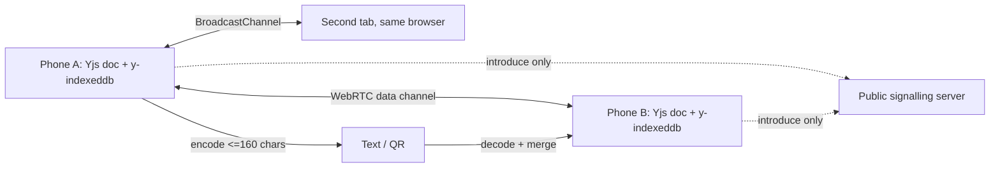

# Design: Seance Board

## Sync transport
- y-webrtc (MIT) default signalling list (npm package README, <https://www.npmjs.com/package/y-webrtc>): `wss://signaling.yjs.dev`, `wss://y-webrtc-signaling-eu.herokuapp.com`, `wss://y-webrtc-signaling-us.herokuapp.com`. Signalling only introduces peers; post data goes over the WebRTC data channel. The community reports these public servers can be down (<https://discuss.yjs.dev/t/is-the-public-signaling-server-that-ships-by-default-with-y-webrtc-still-working/1979>), so the builder checks them live; the room name is random and shared by QR or text.
- Fallback "two tabs on one laptop": y-webrtc's BroadcastChannel (same browser, no network). Demo path if signalling is down.
- Optional: user-set signalling URL, or self-hosted `bin/server.js` from y-webrtc (no cost).

## Data flow

Every device writes and every device is a replica. No device is the source of truth.

## Skeleton modules
- USES: `crdt.ts` (createDoc, merge), `payload.ts` (createCodec: fields id, text, category, created, removed), `lantern.ts` (peers connected or not), `i18n.ts`, `clear.ts`, `pwa.ts`, `styles/base.css`.
- DOES NOT USE: `store.ts` Dexie records (y-indexeddb holds the data), any `lastSeen` price caching, any snapshot fetch or scheduled job.

## UI layout (distinct: a compose-and-wall board)
Top: lantern shows peer count ("2 spirits nearby"). Centre: a card wall of posts, newest first, each with a "synthetic" tag on seed posts. Bottom: a compose bar with a 100-character counter and category chips; the help-line footer sits under it. Side sheet: "Meet" (room name, QR, signalling URL) and "Share as text / Paste code". No price, trend or weather views.

## Tests (Vitest, fast-check 1000 runs)
- PBT: convergence, N replicas receive the same updates in any order and duplicated, all equal (1000 runs).
- PBT: codec round trip for any valid post; any post over 160 chars throws `PayloadTooLargeError` (1000 runs).
- PBT: decode-and-merge of the same code twice leaves one post (idempotent, 1000 runs).
- PBT: random malformed strings never crash decode and never change the doc (1000 runs).
- Unit: delete merges to peers; seed posts keep the synthetic label.
- Two-tab e2e (sbx browse): post in tab 1 appears in tab 2 through BroadcastChannel; reload offline shows the posts.
- axe scan zero serious or critical; Clear all empties IndexedDB; footer shows 14416 and 112.
